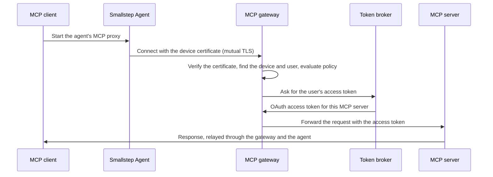

The Smallstep MCP gateway puts the Model Context Protocol (MCP) servers your team uses behind device identity.
An AI agent on an enrolled device reaches an MCP server, such as GitHub or Linear, through the gateway.
It proves itself with the device's certificate, and no API key is stored on the laptop.
The gateway records every session and tool call, and it can apply an access policy to each call.

<Alert severity="info">

The MCP gateway is in early access.
<a href="https://support.smallstep.com/en/contact-us">Contact Smallstep</a> to turn it on for your team.

</Alert>

## The problem it solves

An MCP client such as Claude Code usually authenticates to an MCP server with a personal access token or an OAuth token that sits in a configuration file on the laptop.
That token proves who the user is.
It doesn't prove which device is using it.
Anyone who copies the token can use it from another machine, and you have no record of what an agent did with it.

The MCP gateway changes three things:

- **No API key on the laptop.**
  The MCP client's configuration holds a command that starts the Smallstep Agent, and nothing else.
  The device's certificate opens the connection, and its private key can't be copied off the device.
- **A record of what agents do.**
  Each connection is a session tied to a user, a device, and an MCP client.
  You can read every call in it, and end the session.
- **Policy on every call.**
  You write rules about which users, devices, and clients may call which tools.
  You can watch what a rule would refuse before you enforce it.

## How a request flows

1. The MCP client starts the Smallstep Agent's MCP proxy as a local MCP server.
   The client's configuration names that command.
   It holds no token and no URL.
2. The agent opens a mutual TLS connection to your team's gateway endpoint and presents the device's certificate.
   The private key stays in the device's TPM or Secure Enclave.
3. The gateway checks that the certificate chains to your team's trust roots.
   It finds the device in your device inventory and reads the user from the certificate.
   A device that isn't active in the inventory is refused.
4. The gateway evaluates your access policy when the client opens a session, and again on every call in that session.
5. The gateway asks the token broker for the user's OAuth access token for that MCP server, and forwards the request with it.
6. The MCP server answers as it would for any authorized client.
   It receives the user's access token and never sees the device certificate.

Mutual TLS protects the connection between the device and the gateway.
The connection from the gateway to the MCP server uses TLS and the user's access token.

## The parts

**MCP server.**
The service an agent calls, such as the GitHub or Linear MCP server, or one you host.
You publish an MCP server through the gateway in the Smallstep console under **Protect → MCP Proxies**.
The console calls each entry an MCP proxy.

**MCP gateway.**
The endpoint that verifies device certificates and forwards requests.
Each team has its own gateway endpoint, shown under **Protect → MCP Gateway**.

**Trust roots.**
The certificate authority (CA) certificate the gateway uses to verify device certificates.
You set it once for the team.

**Device credential.**
When you add an MCP server, Smallstep creates a credential for it.
The Smallstep Agent on each device requests a certificate from that credential and renews it without anyone's help.
The certificate is valid for 24 hours.

**The agent's MCP proxy.**
A command in the [Smallstep Agent](./smallstep-agent.mdx) that an MCP client runs as a local MCP server.
It relays the client's requests to the gateway over the agent's connection.

**Token broker.**
The service that holds each user's OAuth grant for each MCP server and hands the gateway an access token when it needs one.

**Session.**
One conversation between an MCP client and an MCP server through the gateway.
A session belongs to the user and the device that opened it.

**Access policy.**
The rules that decide whether a call may go ahead, written in [Cedar](https://www.cedarpolicy.com/).

**Decision.**
The recorded outcome of evaluating the access policy for one call.

## What the device proves

The certificate a device presents to the gateway comes from a **hardware-attested** key.
That is a stronger claim than a hardware-bound key.

- A **hardware-bound** key is generated inside the device's TPM or Secure Enclave and can't be exported.
  The device can use the key, and nobody can copy it to another machine.
- A **hardware-attested** key is hardware-bound, and the hardware has proven it.
  Before Smallstep issues the certificate, the secure hardware gives the CA cryptographic evidence that it generated the key and holds it.
  The CA issues the certificate only when that evidence checks out for a device it knows.

Without attestation, a certificate request says where the key lives, and the CA has to take the device's word for it.
With attestation, the CA has verified it.
[Core Concepts](./core-concepts.mdx#device-attestation) explains device attestation in more depth.

Smallstep issues a certificate for an MCP server only to a device with high assurance in your inventory.
The gateway reads the user from the certificate, so the device also needs a user assigned.

The gateway relies on the device inventory and the user assignments you already have in Smallstep.
It works the same way whichever MDM and identity provider those come from.

## Where the OAuth token lives

MCP servers still authorize people with OAuth.
The gateway moves the token off the device.

The first time a person uses an MCP server through the gateway, they get a link to approve access in their browser.
They sign in to the MCP server's provider and approve, as they would for any OAuth app.
The resulting grant goes to the token broker.
The broker encrypts it with a key that belongs to your team.

After that, the gateway gets the access token from the broker and adds it to each request on the way to the MCP server.
The token never reaches the device, the agent, or the MCP client.

Each team uses its own OAuth app for each MCP server.
You register the app with the provider and give its client ID and client secret to Smallstep when you add the MCP server.

## Access policy

An access policy is a set of Cedar statements.
A statement can refer to the user, the device and its inventory attributes, the MCP client, the MCP server, and the tool being called.

The gateway evaluates the policy in one of three modes:

- **Off.** Nothing is evaluated. This is the starting mode.
- **Monitor.** Every call is evaluated and the decision is recorded. Nothing is refused.
- **Enforce.** Every call is evaluated and recorded, and a call the policy denies is refused.

Monitor shows you what a policy would refuse, on real traffic, before you turn on Enforce.

A refused call returns an error to the MCP client inside the MCP conversation.
The agent can read it and tell the person that their organization's policy blocked the call.

The [MCP gateway reference](./mcp-gateway-reference.mdx) lists what a policy can refer to.

## What is recorded

- **Sessions.**
  Who connected, from which device, with which MCP client, to which MCP server, and when the session ended and why.
- **A timeline for each session.**
  Each call, each policy decision, and each token exchange, in order.
- **Decisions.**
  The outcome of each policy evaluation, the policy that determined it, and the exact set of policy versions in force.
- **Events.**
  MCP activity also appears in your team's audit events, next to device and certificate events.

Sessions and their timelines are recorded in every mode, including Off.
Decisions are recorded in Monitor and Enforce.

By default the gateway keeps a hash and the size of a tool call's arguments, and not the arguments themselves.
You can turn on argument capture for your team to store them.

## What the gateway doesn't do

- **It doesn't make an enrolled device safe to compromise.**
  The gateway stops a copied credential from working anywhere else.
  It doesn't stop prompt injection, a malicious MCP server, or software already running on an enrolled device from using that device's access.
- **It doesn't reach agents that run somewhere else.**
  The MCP client has to run on the enrolled device and start the agent's MCP proxy there.
  An agent hosted in a vendor's cloud can't present your device's certificate.
- **It doesn't stop someone from going around it.**
  A person can still connect an MCP client directly to an MCP server with a token of their own.
  Preventing that depends on the controls the MCP server and the MCP client offer.
- **Ending a session doesn't remove access.**
  Revoking a session disconnects it.
  The MCP client can open a new session if the device is still active and the policy allows it.

## Next steps

- [Protect MCP Servers](../tutorials/protect-mcp-servers.mdx): put an MCP server behind the gateway and connect an MCP client.
- [Control MCP access with policy](../tutorials/mcp-gateway-policy.mdx): write a policy, watch what it would refuse, and enforce it.
- [Audit MCP activity](../tutorials/mcp-gateway-audit.mdx): read sessions, timelines, and decisions, and end a session.
- [MCP gateway reference](./mcp-gateway-reference.mdx): the policy schema, the values a session or a decision can have, limits, and error messages.
